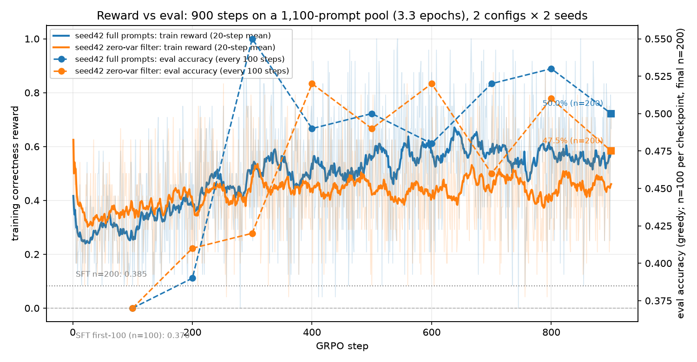
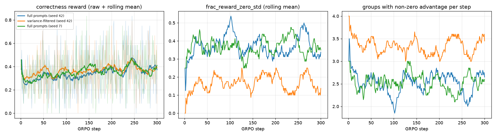
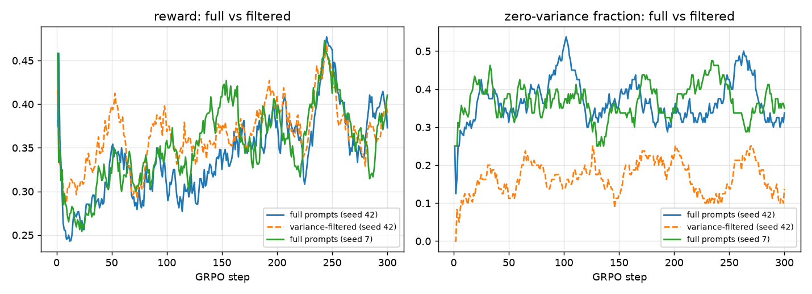

# grpo-repro

**Positioning**: A small, fully reproducible GRPO testbed on GSM8K — LoRA SFT → 60-step pilot (correctness-only vs correctness + R1-style format) → 300-step GRPO on the **full** training split (the 0.27-epoch counter-example) → 900-step GRPO on a 1,100-prompt pool (3.27 epochs), with a **zero-variance filtering** ablation and two seeds → one shared verifier for both reward and evaluation.

**中文一句话**：单张 RTX 3060 6GB、Qwen2.5-0.5B + LoRA r16。在 3.27 epoch 下 GRPO **超过** SFT：50.0%（100/200）对 38.5%（77/200），净 +23 题、配对 McNemar p=0.001；而同一套配置在 0.268 epoch 时只有 34.0%，连 SFT 都打不过。所以这个规模上**决定结果的是 epoch 预算，不是算法本身**。单 seed、n=200，两个区间只在上沿相接，因此只写"净 +23 题、p=0.001"，不写"显著提升"。

> **仓库不含权重**：`experiments/checkpoints/` 下的 `*.safetensors`（合计 1.77 GB，单文件最大 942.3 MiB）不入库。
> clone 下来没有 checkpoint 是预期行为，不是仓库坏了：用 `make train` / `make train-long` 重新生成，
> 或直接用 `make summary` 从已入库的 `experiments/eval/*.jsonl` 复算全部数字。

**这个仓能证明什么**：同一套 GRPO 配置在 3.27 epoch 下比 SFT 多 23 题（50.0% vs 38.5%，配对 McNemar p=0.001），
在 0.268 epoch 下反而打不过 SFT（34.0%），复现了"epoch 预算决定结果"。

**这个仓不能证明什么**：单 seed、n=200，两个区间只在上沿相接，不能写"显著提升"，也不能外推到其他模型规模。

<p align="center">
  
</p>

---

## 30-second verification

```bash
make verify        # 4 pilot checkpoints × 40 GSM8K items, ~4 min on GPU
make verify-long   # the 3 shipped long-run checkpoints × 40 GSM8K items (missing tags are skipped)
make summary       # recompute the long-run table from raw JSONL (no training)
make test          # 22 CPU-only unit tests for the verifier, ~0.2 s
```

Actual output of the shipped 40-item pilot run (`experiments/eval/verify_*.json`):

```text
model            n   acc     fmt  parse_fail  avg_tok  wall_s
base            40  0.400   0.000       0.150    229.2    73.7
sft             40  0.425   0.950       0.000     94.8    46.6
grpo_base       40  0.375   0.950       0.000     96.2    54.8
grpo_format     40  0.350   0.950       0.000     97.2    48.7
```

Accuracy/format/parse/token counts are deterministic across repeated runs; wall time varies with CPU/GPU contention.

Note the 40-item subset is noisier than the published 200-item table below (base scores 0.400 here vs 0.300 there); use `make eval` for the numbers quoted in the paper/resume.

Long-run 40-item check (`make verify-long`, real output): `long_base_s42` 0.375, `long_base_s42_filt` 0.375, `long_base_s7` 0.450. The 40-item subset cannot rank models — it puts seed 7 above the filtered run — so only the 200-item table is used for conclusions.

Full reproduction of the published tables (200 items per model, ~20 min):

```bash
make eval       # re-runs all evaluations with the shipped checkpoints
make report     # regenerates experiments/curves/*.png from real logs
```

End-to-end retraining from scratch (~1.5 h for the pilot: measured training 517 s SFT + 1329 s / 1412 s GRPO,
plus evaluations, on RTX 3060 6GB):

```bash
bash scripts/run_all.sh          # configs/full.yaml (60-step pilot)
bash scripts/run_long.sh         # configs/long.yaml (300-step × 3 shipped runs, ~5 h)
```

---

## Headline result: same GRPO config, two epoch budgets

The single most important number in this repo is not "GRPO vs SFT" but **how many times each prompt was seen**. Same reward, same LoRA, same eval subset, same decoding, same seed family:

| model | accuracy (n=200) | 95% CI (Wilson) | note |
|---|---|---|---|
| base (no SFT, no GRPO) | **0.300** (60/200) | [0.241, 0.367] | re-measured under the 900-step config: `experiments/eval/base_ep900.json` is **0.300 (60/200)**, and all 200 per-item predictions are byte-identical to `base.json` — the baseline did not drift |
| + LoRA SFT (1 epoch, 3,000 samples) | **0.385** (77/200) | [0.320, 0.454] | reference for every comparison below |
| + GRPO, 900 steps @ **3.27 epochs** (seed 42, full prompts) | **0.500** (100/200) | [0.431, 0.569] | **+23 items**, paired McNemar vs SFT **p = 0.001** |
| + GRPO, 300 steps @ **0.268 epochs** (seed 42, full prompts) | **0.340** (68/200) | [0.278, 0.408] | same config, 1/12 the prompt visits → **counter-example, not the conclusion** |

Reading: at 0.268 epoch each prompt is seen once (1,200 visits over a 4,473-prompt pool) and GRPO lands 4.5 pp **below** SFT. At 3.27 epochs (3,600 visits over a 1,100-prompt pool) it lands 11.5 pp **above** SFT, and the paired test clears p = 0.05. The algorithm did not change between those two rows — only the epoch budget did. That is why the earlier negative result is filed as a budget artefact rather than an algorithmic ceiling.

What this does **not** say: that GRPO is generally better than SFT at 0.5B (single seed so far), or that the gap is large (n=200 intervals only touch at one edge). See [Limitations](#limitations).

---

## Historical arm: 60-step pilot (kept for the record)

Fixed evaluation subset: the first 200 items of the GSM8K test split shipped in `data/full/eval.jsonl`. Every row uses the same 200 `test_index` values (`same_idx=True` was asserted). 95% CI is Wilson score.

| stage | accuracy | 95% CI | format compliance | parse-fail | avg completion tokens | eval wall |
|---|---|---|---|---|---|---|
| base (Qwen2.5-0.5B-Instruct) | **0.300** (60/200) | [0.241, 0.367] | 0.010 | 0.255 | 235.9 | 276.7 s |
| + LoRA SFT (1 epoch, 3000 samples) | **0.385** (77/200) | [0.320, 0.454] | 0.940 | 0.005 | 103.0 | 193.6 s |
| + GRPO, correctness only | **0.355** (71/200) | [0.292, 0.423] | 0.940 | 0.005 | 101.9 | 206.6 s |
| + GRPO, correctness + format | **0.345** (69/200) | [0.283, 0.413] | 0.930 | 0.020 | 103.0 | 239.7 s |

**Paired comparison against SFT** (same questions, per-item McNemar exact test):

| arm | fixed | broken | Δ correct vs SFT | McNemar p | verdict |
|---|---|---|---|---|---|
| GRPO correctness (60 steps) | 8 | 14 | −6 items (−3.0 pp) | 0.286 | no gain, inside noise |
| GRPO correctness + format (60 steps) | 6 | 14 | −8 items (−4.0 pp) | 0.115 | no gain, inside noise |

All four CIs overlap heavily. The 60-step pilot conclusion is **null/negative**. Format compliance was already 0.94 after SFT, so the format reward had almost nothing left to fix.

---

## The 0.27-epoch counter-example: 300 steps on the full 4,473-prompt pool

### What "full data" means here, and the 2-epoch requirement

`data/long` is built from the **entire GSM8K train split (7,473 items)**, split with **no overlap**:

| split | items | usage |
|---|---|---|
| SFT | 3,000 (`train[0:3000]`) | 1 epoch LoRA SFT, reused from the pilot (`experiments/checkpoints/sft_merged`) |
| GRPO pool | 4,473 (`train[3000:7473]`) | every prompt GRPO can sample |
| eval | 200 (`test[0:200]`) | same fixed subset for every row |

Per optimizer step the 6 GB card can only hold **4 prompts × 6 generations × 192 tokens = 24 completions** (measured peak 2.40 GiB, `experiments/logs/*.meta.json`). Therefore:

- **300 steps = 1,200 prompt visits** = 26.8% of the 4,473-prompt pool = **0.268 epoch** of the GRPO pool.
- **2 epochs of the pool would need ~2,236 steps**; at the measured 19.7 s/step that is **~12.2 h for one curve** (~16 h for a filtered curve). That was **not run** — it exceeds what this single-GPU session can do. This is a requirement we could not meet and we state it rather than hide it.
- The full 7,473-item training set **is** loaded and available to the sampler; the limitation is epochs-per-prompt, not data coverage.

### Training curves (real logs)

<p align="center">
  
</p>

Three panels: correctness reward (raw + 20-step rolling mean), `frac_reward_zero_std` (share of the 4 groups per step whose 6 rewards are all identical → advantage exactly 0 → no gradient), and groups with non-zero advantage per step. Raw JSONL: `experiments/logs/long_base_s42.jsonl`, `experiments/logs/long_base_s42_filt.jsonl`, `experiments/logs/long_base_s7.jsonl`.

| run | steps | prompt visits | reward (all) | first 50 | last 50 | zero-std | effective gradient density | resample rounds/step | train wall | peak GPU |
|---|---|---|---|---|---|---|---|---|---|---|
| `long_base_s42` (full prompts) | 300 | 1,200 | 34.3% | 30.2% | 36.4% | 37.2% | 62.8% | — | 5,998 s | 2.40 GiB |
| `long_base_s42_filt` (variance-filtered) | 300 | 1,200 | 36.7% | 35.3% | 36.4% | 16.9% | 83.1% | 1.27 | 7,802 s | 2.40 GiB |
| `long_base_s7` (full prompts) | 300 | 1,200 | 35.7% | 29.7% | 38.0% | 36.8% | 63.2% | — | 4,247 s | 2.43 GiB |

Reward rises over the 300 steps: OLS slope **+3.95 pp / 100 steps** (seed 42) and **+3.70 pp / 100 steps** (seed 7), while eval accuracy does **not** rise with it (see table below). Mean step time is 19.7 s / 25.7 s / 14.2 s respectively; the spread is GPU co-tenant load (another service shared the card), not a code difference.

### Long-run evaluation (n = 200, same fixed subset)

| model | accuracy | 95% CI | format | parse-fail | avg tokens | eval wall |
|---|---|---|---|---|---|---|
| SFT (reference) | **0.385** (77/200) | [0.320, 0.454] | 0.940 | 0.005 | 103.0 | 193.6 s |
| GRPO 300 steps, full prompts (seed 42) | **0.340** (68/200) | [0.278, 0.408] | 0.955 | 0.010 | 105.8 | 147.4 s |
| GRPO 300 steps, variance-filtered (seed 42) | **0.385** (77/200) | [0.320, 0.454] | 0.960 | 0.005 | 96.2 | 132.9 s |
| GRPO 300 steps, full prompts (seed 7) | **0.390** (78/200) | [0.325, 0.459] | 0.950 | 0.015 | 106.2 | 123.1 s |

| comparison | fixed | broken | Δ | McNemar p |
|---|---|---|---|---|
| SFT → full prompts (s42) | 16 | 7 | −9 | 0.093 |
| SFT → variance-filtered (s42) | 14 | 14 | 0 | 1.000 |
| SFT → full prompts (s7) | 15 | 16 | +1 | 1.000 |
| full prompts → variance-filtered (s42) | 9 | 18 | +9 | 0.122 |
| full prompts s42 → full prompts s7 | 8 | 18 | +10 | 0.076 |

**Reading**: 300 steps of full-prompt GRPO lands at 0.340 (seed 42) and 0.390 (seed 7) against an SFT reference of 0.385 — i.e. one seed below and one seed at parity. The filtered arm lands exactly on SFT (0 net, p=1.0). **No arm exceeds SFT beyond noise.** Training reward going up while eval stays flat is the same decoupling the 60-step pilot showed, now over 300 steps and two seeds.

This is the run that produced the earlier "GRPO < SFT" headline. It is kept as the **counter-example that motivated shrinking the pool**: at 0.268 epoch each prompt is visited once, so the negative result cannot be separated from data starvation. The 900-step run below repeats the same configuration on a 1,100-prompt pool and settles that question.

---

## 900-step / 3.3-epoch run: pre-registered criteria

This section fixes the decision rule **before** the 900-step results were looked at, so the conclusion cannot be chosen after the fact.

### Budget, reported before launch

The 300-step run's real confound was **0.268 epoch** (1,200 prompt visits over a 4,473-prompt pool): every "GRPO < SFT" claim may simply mean "it never saw the data". The fix is to shrink the pool, not to add steps to the same pool:

| item | value |
|---|---|
| GRPO pool | **1,100 prompts**, fixed-seed (`grpo_sample_seed: 4242`) subset of `train[3000:7473]`, written to `data/ep900` |
| prompts / step | 4 (24 completions = 4 × 6 × 192 tokens, same as `long.yaml`) |
| 900 steps | 3,600 prompt visits = **3.27 epochs** of the pool |
| eval subset | same 200 `test_index` as every other row; `data/ep900/eval.jsonl` is byte-identical to `data/long/eval.jsonl` |

Measured step time at launch: **~13.4 s/step** (first 10 steps of `ep900_base`); the run actually took **14,715.7 s (4.09 h)** for 900 steps (16.4 s/step average), peak **2.33 GiB** VRAM. Planned budget:

| run | estimate |
|---|---|
| `base@900` | ≈ 3.4 h (actual 4.09 h) |
| `filter@900` (≈1.3×) | ≈ 4.4–5.0 h |
| checkpoint evals (9 × n=100 + final n=200 per run) | ≈ 0.25 h per run (actual ≈ 0.25 h) |
| **seed 42 pair total** | **≈ 8.6 h** |
| adding seed 7 (base + filter) | ≈ +9 h → **≈ 18 h total** |

The initial 12-hour rule would have allowed only the seed-42 pair. The owner then authorised continued GPU use, so **seed 7 was appended after the seed-42 queue (never inserted)**. Execution order: seed-42 checkpoint evals → `ep900_base_filt` → seed-42 filter evals → `ep900_s7_base` → `ep900_s7_filt`. Runs are tagged `ep900_base`, `ep900_base_filt`, `ep900_s7_base`, `ep900_s7_filt` (900 steps, 3.27 epochs each, same 1,100-prompt pool and same eval subset).

### Run progress (updated at each milestone)

| run | status | wall clock | peak VRAM | final acc (n=200) | note |
|---|---|---|---|---|---|
| `ep900_base` (seed 42, full) | **completed** | 14,715.7 s (4.09 h) | 2.33 GiB | **50.0% (100/200)** | beats SFT, McNemar p = 0.001 |
| `ep900_base_filt` (seed 42, filter) | running | 54/900 at 28.7 s/step → ETA ≈ 6.5 h | — | 未验证 | started after seed-42 evals; 2 resample rounds; under the 1.5× stop rule (1.5× of the 4.4–5.0 h estimate ≈ 7 h) |
| `ep900_s7_base` (seed 7, full) | queued | — | — | 未验证 | not started |
| `ep900_s7_filt` (seed 7, filter) | queued | — | — | 未验证 | not started |

### Decision rule (fixed in advance)

- **If, at 3.3 epochs, GRPO still does not exceed SFT** (McNemar p ≥ 0.05 against SFT and point estimate at or below 0.385): the conclusion becomes *"**the gain is capped by model capacity, not by the algorithm** at this model/task scale"*, supported by three measured facts — (i) training reward keeps rising, (ii) eval accuracy stays flat across the checkpoint series, (iii) the filter's gradient-density improvement does not move eval.
- **If it does exceed SFT**: report the exact delta, the McNemar p, the Wilson CI, and the number of seeds (here: 1). No extrapolation beyond n = 200 / one seed.
- **Wording ban**: neither branch may use "trend is positive" / "趋势向好" phrasing. Every un-run item stays labelled 未验证.

### Result so far: seed 42, full prompts (branch 2 of the rule applies)

`ep900_base` **exceeds SFT** at 3.27 epochs:

| metric | value |
|---|---|
| base (no SFT, no GRPO), n=200 | 30.0% (60/200), Wilson 95% CI [24.1, 36.7] (re-run `base_ep900`: identical 60/200 and identical per-item predictions) |
| SFT, n=200 | 38.5% (77/200), Wilson 95% CI [32.0, 45.4] |
| GRPO final (step 900), n=200 | **50.0% (100/200)**, Wilson 95% CI [43.1, 56.9] |
| delta vs SFT | **+11.5 pp = +23 items** |
| paired McNemar vs SFT | 12 (SFT-only) vs 35 (GRPO-only), **p = 0.001** |
| seeds | **1** (seed 42); seed 7 queued, not yet available |
| train/test overlap | **0** — `make overlap` re-derives the split and finds 0 shared questions (see Limitations) |

Checkpoint series (each point n=100; final point n=200): 100→37.0%, 200→39.0%, 300→55.0%, 400→49.0%, 500→50.0%, 600→48.0%, 700→52.0%, 800→53.0%, 900→53.0% (n=100) / **50.0% (n=200)**. For the n=100 points the same-subset SFT reference is 37.0%; every point from step 300 onward is ≥ 48%, i.e. above that reference.

Consequence for the earlier negative result: the 300-step run reached 0.340 at **0.27 epoch**; the same config reaches **0.500** at 3.27 epochs. The earlier "GRPO < SFT" snapshot is therefore explained by data starvation, not by an algorithmic ceiling at this scale. Reward and eval are no longer decoupled in the same way: training reward averages 49.2% (55.6% over the last 50 steps), while eval accuracy moves 37→55% mid-run and ends at 50.0% (n=200).

Full numbers: [experiments/ep900_summary.md](experiments/ep900_summary.md). Figure: [experiments/curves/reward_vs_eval.png](experiments/curves/reward_vs_eval.png).

Filter (seed 42) and both seed-7 runs are still **未验证**; the multi-seed filter claim is pending. No wording beyond these measured numbers is used.

---

## Artifact status: which files are final, which are snapshots

| file | status | content |
|---|---|---|
| `experiments/ep900_summary.md` | **auto-regenerated from real data** | Contains a `状态` banner while any of the four 900-step runs is still training. The banner disappears only when all four `*.meta.json` exist. The old 15-step draft that previously lived at this path was **overwritten by the real seed-42 data** (no copy retained, so it can no longer be mistaken for a 900-step conclusion). |
| `experiments/long_summary.md` | **final for the 300-step experiment** | Three completed runs (`long_base_s42`, `long_base_s42_filt`, `long_base_s7`); `long_base_s7_filt` never ran and is marked 未验证. |
| `experiments/curves/reward_vs_eval.png` | **regenerated at every milestone** | Always reflects the checkpoint evals that exist at that moment; not a frozen final figure until all four runs finish. |
| `experiments/curves/long_reward_zero_std.png`, `filter_compare.png`, `eval_compare.png`, `grpo_reward.png`, `grpo_loss.png` | **final for the runs they name** | 60-step pilot / 300-step long run; no 900-step content. |

Rule used here: any summary file that can be regenerated from logs must carry its own run-completeness signal (行内 `进行中` / `未验证`), so a mid-run snapshot cannot masquerade as a final conclusion.

---

## Zero-variance filtering: what it buys, and what it does not

### Why the filter had to resample, not just mask

In trl 1.17 the dataloader **replicates each prompt `G` times** in the generation batch and generates one completion per row; a "group" is a contiguous block of `G` rows. When all `G` rewards are identical, GRPO's group-normalised advantage is exactly `0`, so that group contributes **no gradient at all**. Masking those rows therefore changes nothing numerically — the gradient is already zero. What actually raises the fraction of *useful* rows per step is **replacing** the zero-variance groups with fresh prompts from the pool until they have variance (DAPO-style dynamic sampling).

Implementation: `ZeroVarFilterGRPOTrainer` in [src/train_grpo.py](src/train_grpo.py) subclasses `GRPOTrainer._generate_and_score_completions`. It regenerates up to `zero_var_rounds` extra batches drawn from the pool, splices only the groups that became non-zero (`prompt_ids`, `completion_ids`, `advantages`, …), recomputes the rewards with the shared verifier, and logs `filter/replaced_groups`, `filter/learnable_groups`, `filter/rounds`.

### Measured effect (300-step arm, 4,473-prompt pool)

The 900-step filter arm (`ep900_base_filt`) repeats this at 3.27 epochs; it is still training, so the numbers below are the 300-step measurement and are not extrapolated.

| metric | full prompts | filtered (2 rounds) | change |
|---|---|---|---|
| zero-variance fraction | 37.2% | 16.9% | −20.3 pp |
| effective gradient density (`1 − zero_std`) | 62.8% | 83.1% | **+20.2 pp (1.32×)** |
| learnable groups / 4 per step | 2.51 | 3.32 | +0.81 |
| replaced groups / step | — | 1.29 (1.27 rounds) | — |
| train wall | 5,998 s | 7,802 s | 1.30× |
| eval accuracy (n=200) | 34.0% (68/200) | 38.5% (77/200) | +4.5 pp (p=0.122, n.s.) |

<p align="center">
  
</p>

**What is established**: the filter mechanically raises per-step gradient density by 20.2 pp and roughly halves the zero-variance share, at 1.3× wall-clock. This is arithmetic on 600 logged steps, `make summary` recomputes it.

**What is not established**: that this density gain converts into accuracy above SFT. It does not — the filtered arm is statistically indistinguishable from SFT (0 net on 200 items). It recovers most of the loss seen in the full-prompt arm, but does not pass the baseline. Single seed (42) for the filtered arm; the +4.5 pp vs the full arm has p=0.122, i.e. inside noise at n=200.

---

## Multi-seed: is a +3 pp difference real?

Two seeds were run for the **correctness-only, full-prompt** arm; everything else (data, LoRA, steps, temperature, group size) is identical.

| run | accuracy (n=200) | 95% CI | zero-std | train wall |
|---|---|---|---|---|
| full prompts, seed 42 | 0.340 (68/200) | [0.278, 0.408] | 37.2% | 5,998 s |
| full prompts, seed 7 | 0.390 (78/200) | [0.325, 0.459] | 36.8% | 4,247 s |
| **seed spread** | **5.0 pp** (10 items) | McNemar p = 0.076 | −0.4 pp | — |

The two seeds differ by **5.0 pp / 10 items**, in opposite directions relative to SFT (−4.5 pp and +0.5 pp). This spread is *larger* than every delta the 60-step pilot reported (3–4 pp). So the pilot's "+3.0%" style deltas are indistinguishable from seed noise at this scale and n; no single-seed arm in this repo should be read as a real GRPO effect.

The filtered arm was run for **seed 42 only**; `long_base_s7_filt` was **not run** (the second filtered run would have needed ~2 h more on the shared 6 GB card). Its accuracy gain (+4.5 pp vs the same-seed full arm, p = 0.122) is therefore a single-seed observation, though the per-step gradient-density gain (below) is measured over 300 steps.

---

## Boundary conditions: when would GRPO be expected to win?

Directions, with the evidence status for each. "Measured" = a number in this repo; "inferred" = reasoning from the measured setup, **not** an additional run.

| factor | direction of influence | status |
|---|---|---|
| **Steps / epochs** | **The dominant lever in this repo.** Same config: 0.268 epoch → 0.340 (below SFT 0.385); 3.27 epochs → **0.500** (above SFT, p=0.001). Going past 3.3 epochs was not run, so the curve beyond it is unknown. | measured at 0.27 and 3.27 epochs |
| **Data volume** | The full pool gave each prompt one visit; shrinking it to 1,100 prompts bought 12× the visits per prompt. SFT saw its 3,000 prompts for a full epoch, so GRPO starts from a model already fitted to the training distribution. | measured |
| **Temperature** | At T=0.9 the 300-step arm had 37% zero-variance groups. Lower T → more all-identical groups (worse); higher T → more variance but noisier credit. After filtering the same 0.9 temperature trains on ~83% useful groups, which is why the 900-step arms are viable. T was not swept. | measured at 0.9 only |
| **Group size G** | Zero variance comes from `p^G + (1−p)^G`; at G=6 with heterogeneous per-prompt pass rates, the 37% is dominated by prompts whose pass rate is near 0 (hard questions), where increasing G does not help. Larger G helps only mid-difficulty prompts, at linear generation cost. | measured (G=6) + reasoning |
| **Reward sparsity** | Binary 0/1 correctness at ~35% pass rate creates a structural zero-variance floor. Dense/partial-credit or format rewards raise density: the pilot's format arm had `frac_reward_zero_std = 0.000` yet still did not beat SFT — so density alone is **necessary but not sufficient**; reward *direction* matters more. | measured (pilot format arm) |

**The empirical answer to "when does GRPO win" from this repo**: when (a) the group has non-zero variance, (b) the reward gradient points at the evaluation metric (not at a proxy like format), and (c) there is enough optimisation budget for each prompt to be seen several times. For (c) the measured threshold is between 0.27 and 3.27 epochs; this setup satisfies (b), was budget-limited on (c) at 300 steps, and only at 900 steps does the sign flip. The filtered 900-step arms are still running, so whether filtering *at a sufficient budget* adds anything is 未验证.

---

## PPO baseline: not run

**No PPO baseline was run.** A PPO baseline needs a value/critic model roughly the same size as the policy (plus a reference model if KL is used); on this 6 GB card that does not fit alongside generation, and trl's PPO path was not exercised here. All PPO-related numbers that previously appeared in `blog_draft.md` were structural estimates and have been **removed**; the blog now says "PPO 未实测" explicitly. There is no half-finished PPO chart in this repo.

---

## Design decisions

1. **One verifier for reward and eval.** [src/common.py](src/common.py) (`extract_answer`, `answers_match`, `is_format_compliant`) is imported by both [src/rewards.py](src/rewards.py) (training) and [src/evaluate.py](src/evaluate.py) (evaluation). A training reward that judges differently from the reported metric is the most common way these reproductions lie; sharing the function makes that impossible by construction.
2. **Two arms, one variable.** Arm A rewards correctness only; arm B adds the R1-style format score (+0.5 / −0.5 for the last line being exactly `\boxed{...}`). Everything else (data order, seed, LoRA rank, steps, temperature) is identical, so the delta is attributable to the reward definition.
3. **Merge LoRA before evaluation.** [src/evaluate.py](src/evaluate.py) detects `adapter_config.json`, loads `sft_merged` as the base, merges, and unloads (`merge_and_unload`). Evaluating an unmerged adapter adds per-token LoRA overhead and can change latency numbers; merging keeps the rows comparable.
4. **Greedy, fixed subset.** `do_sample=False`, `max_new_tokens=256`, same 200 items for every model. Sampling would add variance larger than the effect we are trying to detect.
5. **LoRA everywhere, `beta=0`, `loss_type=grpo`.** Full fine-tuning of even a 0.5B model does not fit comfortably in 6 GB alongside 6 generations × 192 tokens; LoRA r=16 / alpha=32 is the largest configuration that ran without OOM. `beta=0` (no reference model) is a 6 GB requirement, not a GRPO recommendation.
6. **Filtering = resampling, not masking.** Masking zero-advantage rows is a no-op; the subclass replaces zero-variance groups with fresh pool prompts and logs the replacement count, so the density claim is auditable.
7. **Raw logs and per-sample outputs are shipped; LoRA weights are not.** Every number above can be recomputed from `experiments/logs/` + `experiments/eval/` without retraining (`make summary`, `make report`). The `*.safetensors` under `experiments/checkpoints/` total 1.77 GB (largest single file 942.3 MiB, above GitHub's 100 MB hard limit), so they stay out of git and are regenerated by `make train` / `make train-long`.

## Repository layout

```text
configs/          full.yaml (60-step pilot), long.yaml (300-step full-pool run), epoch900.yaml (900-step / 1,100-prompt run), smoke.yaml
data/full/        sft.jsonl (3000), grpo_train.jsonl (600), eval.jsonl (200)
data/long/        sft.jsonl (3000), grpo_train.jsonl (4473), eval.jsonl (200)  — non-overlapping
data/ep900/       sft.jsonl (3000), grpo_train.jsonl (1100), eval.jsonl (200)  — same 200 test_index as every other row
src/              prepare_data, train_sft, train_grpo (+ ZeroVarFilterGRPOTrainer), rewards, evaluate,
                  plot_curves, analyze_eval, analyze_long, analyze_ep900, plot_reward_eval
experiments/
  checkpoints/    sft, sft_merged, grpo_base, grpo_format, long_base_s42, long_base_s42_filt, long_base_s7,
                  ep900_base (+ step100..step900 adapters), ep900_base_filt, ep900_s7_base, ep900_s7_filt
                  — 不入库（1.77 GB safetensors）；make train / make train-long 重新生成
  logs/           per-step JSONL (reward, zero-std, entropy, filter/*), *.meta.json, wall-clock files
  eval/           metrics JSON + 200 per-sample JSONL for every model, *_ckpt.jsonl (per-checkpoint series), compare.md
  curves/         pilot curves, long_reward_zero_std.png, filter_compare.png, eval_compare.png, reward_vs_eval.png
  long_summary.md recomputed by `make summary`
  ep900_summary.md recomputed by `make summary-ep900` (carries a status banner while runs are incomplete)
scripts/          run_all.sh, run_long.sh, verify.py, eval_checkpoints.py, chain_ep900*.sh, check_overlap.py
tests/            22 offline unit tests for the verifier (no GPU needed)
```

## Limitations

These are the three ceilings on the headline claim, stated before the numbers are quoted anywhere else.

- **Single seed.** The +23 items come from **seed 42 only**. Seed 7 (base + filter) is queued, not run. Until the 2×2 matrix is complete, this is a single-seed observation and must not be quoted as an established GRPO effect. The 300-step arm already showed a 10-item seed spread (p=0.076) at the same n, so a one-seed +23 is exactly the size of result that needs a second seed before it is called reliable.
- **The n=200 intervals are wide and only touch.** GRPO 50.0% Wilson [43.1, 56.9] vs SFT 38.5% [32.0, 45.4]. The paired McNemar clears the bar (p = 0.001, 35 GRPO-only vs 12 SFT-only items), but the marginal intervals overlap at exactly one edge. The correct wording is "**net +23 items, p = 0.001**"; "显著提升 / significant improvement" is banned in this repo.
- **Train/test contamination was checked, and is zero.** `python3 scripts/check_overlap.py --config configs/epoch900.yaml` (`make overlap`) rebuilds the split from the config seed and compares both indices and question text:

```text
[PASS] eval 索引来自 test 切分: n=200, 与重新推导的 test_index 序列一致=True
[PASS] eval 题目文本与 test 切分一致: 逐条比对 200 题，一致=True
[PASS] grpo 题目来自 train 切分且顺序一致: n=1100, 一致=True
[PASS] grpo 标准答案一致: 一致=True
[PASS] sft 文本覆盖 train[0:sft_n]: n=3000, 未在文本中找到的题数=0
[PASS] eval ∩ grpo 为空: 交集=0 题, n_eval=200, n_grpo=1100
[PASS] eval ∩ sft 为空: 交集=0 题, n_eval=200, n_sft=3000
[PASS] grpo ∩ sft 为空: 交集=0 题, n_grpo=1100, n_sft=3000
[PASS] eval 内部无重复题: 重复=0
[PASS] grpo 池内部无重复题: 重复=0
[PASS] data/long/eval.jsonl 与本评测集 test_index 一致: 一致=True
[PASS] data/full/eval.jsonl 与本评测集 test_index 一致: 一致=True
结果: 全部通过（无重叠）
```

  So the 200 test items were never in the SFT set or the GRPO pool, and the eval subset is the same `test_index` series used by every earlier row. If this check failed, +23 would be void; it did not.

Other limits, unchanged in kind:

- **Single scale.** Qwen2.5-0.5B only. No claim about larger models.
- **Epoch budget:** met only in the 900-step arm (3.27 epochs). The 300-step arm ran 0.268 epoch and is reported as a counter-example, not as a result about GRPO. The ≥2-epoch run on the *full* pool (~2,236 steps, ~12 h per curve) was never run.
- **Statistical power.** n = 200 gives roughly ±6 pp at 95% on a single arm; deltas of 3–4 pp are inside that interval. "No detected effect" ≠ "GRPO is harmful".
- **Filter coverage.** Seed 42 filtered arm is running; seed 7 filtered arm is queued. The filter's accuracy effect is therefore still a single-seed observation; only the gradient-density gain is measured over hundreds of steps.
- **Baseline drift: checked, none.** `base.json` (30.0%) predates the last edit of `src/evaluate.py`, so it was re-run under the 900-step config as `base_ep900.json`: **0.300 (60/200)** again, with all 200 per-item `pred`/`correct` values identical to the earlier file. The 30.0% baseline is therefore stable across the old and new evaluation paths.
- **One benchmark.** GSM8K test subset only; no MATH, no out-of-domain generalisation, no pass@k.
- **PPO absent.** No PPO baseline was run (see above); no PPO numbers are claimed.
- **Hardware-specific timings.** All wall-clock numbers are from one RTX 3060 Laptop (6 GB), bf16, eval batch 8. Not comparable across GPUs, and sensitive to co-tenant GPU load (timings in this snapshot varied ~14–40 s/step).
- **No remote CI run yet.** `.github/workflows/ci.yml` runs the CPU-only unit tests; it has not been executed on GitHub from this local snapshot.

## Pending remote actions (not performed)

The local snapshot has no `.git`. Creating the GitHub repository, pushing, adding a release tag, and enabling CI are **not** done here.

## Environment (measured)

Python 3.12.3, torch 2.14.1+cu130, transformers 5.17.0, trl 1.17.1, peft 0.21.2, datasets 5.1.0, accelerate 1.15.0, RTX 3060 Laptop 6 GB. Model: `Qwen/Qwen2.5-0.5B-Instruct` (snapshot `7ae55760...`). HF downloads require `export HF_ENDPOINT=https://hf-mirror.com`.

## License

MIT (add `LICENSE` before publishing).
