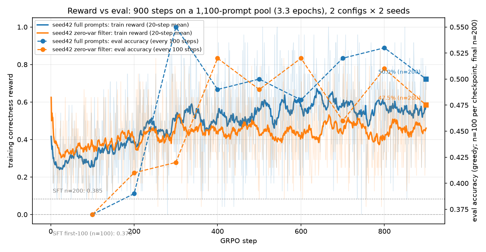

# GRPO 在什么条件下才值得用：0.27 epoch 打不过 SFT，3.27 epoch 净 +23 题

这不是一篇"GRPO 比 PPO 省显存"的科普，而是一份**带预算变量的实验记录**：Qwen2.5-0.5B + LoRA r16、单张 RTX 3060 Laptop 6GB、GSM8K、固定 200 题评测子集。

核心结论只有一句：**同一套 GRPO 配置，在 0.268 epoch 时连 SFT 都打不过（34.0% vs 38.5%），在 3.27 epoch 时是 50.0% 对 38.5%，净 +23 题、配对 McNemar p=0.001。** 之前的负结果不是"GRPO 没用"，而是"每题只被看过一次"。这也是为什么这篇把 300 步那段降级成**预算不足的反例**，而不是结论本身。

文中每个数字都来自本仓库的日志或评测文件，复算入口写在最后。没跑过的东西（PPO、第二个 seed、900 步过滤组）明确标"未验证"，不写估算。

---

## 一句话结论

| 问题 | 实测答案 |
|---|---|
| 3.27 epoch 的 GRPO 能超过 SFT 吗？ | **能**：50.0%（100/200）对 38.5%（77/200），净 **+23 题**，配对 McNemar **p=0.001** |
| 那 300 步的负结果呢？ | 那是 **0.268 epoch** 的反例（34.0%，低于 SFT），不是算法上限 |
| 这个 +23 有多稳？ | **单 seed（42）**；GRPO [43.1, 56.9] 与 SFT [32.0, 45.4] 只在上沿相接。只写"净 +23 题、p=0.001"，不写"显著提升" |
| 评测集被训练污染了吗？ | **没有**：200 题评测 ∩ 1,100 题 GRPO 池 = 0，∩ 3,000 题 SFT = 0，索引与文本双重检查全部 PASS |
| base 基线漂了吗？ | **没有**：用 900 步配置重测 `base_ep900`，仍是 **30.0%（60/200）**，200 条逐题预测与旧文件完全一致 |
| 零方差过滤有用吗？ | **未定**。300 步臂上梯度密度 62.8%→83.1%，但准确率只回到 SFT；900 步过滤组仍在训练，2×2 矩阵跑完再下结论 |
| 训练奖励在涨吗？ | 900 步臂奖励均值 49.2%，后 50 步 55.6%；评测也不再是"平"的：37→55% 中途抬升，末点 50.0%（n=200） |

一句话的"什么时候值得用"：**组内有方差、奖励指向评测指标、每题被看够几遍**。前两条这次满足，第三条 300 步时没有，900 步时满足了——这就是全部差别。

---

## 实验设置与预算（真实约束，不粉饰）

| 项 | 值 |
|---|---|
| 数据 | GSM8K：SFT 3,000 题（`train[0:3000]`）；GRPO 题库两套——4,473 题全量（300 步反例）与 **1,100 题固定 seed 子集**（900 步主实验）；评测 200 题来自 `test`，三者**互不重叠** |
| 评测 | 同一批 200 个 `test_index`，greedy，`data/ep900/eval.jsonl` 与 `data/long`、`data/full` 逐字节同集（`test_index` 序列一致） |
| 模型 | Qwen2.5-0.5B-Instruct + LoRA r=16 / alpha=32，bf16，`beta=0`（无参考模型） |
| 每步 batch | 24 completions = 4 prompts × 6 generations × 最多 192 token |
| 峰值显存 | **2.33–2.43 GiB**（实测 meta.json） |
| 900 步的 epoch | 3,600 次 prompt 访问 / 1,100 题库 = **3.27 epoch** |
| 300 步的 epoch | 1,200 次 prompt 访问 / 4,473 题库 = **0.268 epoch** |

预算当初就报过：`base@900` 实测 **14,715.7 s（4.09 h）**、16.4 s/步、峰值 2.33 GiB；过滤组约 1.3 倍。seed 42 的 base + filter + 20 次 checkpoint 评测合计约 8.6 h；seed 7 追加在队尾，不插队。

---

## 主结果：同一个配置，两种 epoch 预算



| 模型 | 准确率 (n=200) | Wilson 95% CI | 备注 |
|---|---|---|---|
| base（未 SFT、未 GRPO） | **30.0%**（60/200） | [24.1, 36.7] | 用 900 步配置重测：`base_ep900` 仍是 **30.0%（60/200）**，且 200 条逐题预测与旧文件完全一致——基线没漂 |
| + LoRA SFT | **38.5%**（77/200） | [32.0, 45.4] | 所有对比的参照 |
| + GRPO，900 步 @ **3.27 epoch**（seed 42，全量 prompt） | **50.0%**（100/200） | [43.1, 56.9] | **+23 题**，对 SFT 配对 McNemar **p=0.001** |
| + GRPO，300 步 @ **0.268 epoch**（seed 42，全量 prompt） | **34.0%**（68/200） | [27.8, 40.8] | 同一配置、1/12 的访问量 → **反例，不是结论** |

**9 个 checkpoint 的逐步准确率**（每个点 n=100；末点另测 n=200）：

| step | 100 | 200 | 300 | 400 | 500 | 600 | 700 | 800 | 900 |
|---|---|---|---|---|---|---|---|---|---|
| acc (n=100) | 37.0% | 39.0% | **55.0%** | 49.0% | 50.0% | 48.0% | 52.0% | 53.0% | 53.0% |

同一 100 题子集上 SFT 是 **37.0%**。也就是说：**从 300 步起的 7 个 checkpoint 全部不低于 48%，最高的单点是 300 步的 55.0%；前两个点（100、200 步）与 SFT 持平。** 末点换到完整 200 题是 50.0%，仍然高于 SFT 的 38.5%。

这里必须说清楚一件事：**训练奖励在涨，评测也在涨，两者不再解耦**——但这不是"曲线看起来在涨"，而是上表 9 个实测点 + 末点 n=200 的算术。

---

## 300 步：预算不足的反例（降级说明）

300 步那轮（全量 4,473 题库）的结论是：

| run（300 步） | 准确率 n=200 | 对 SFT |
|---|---|---|
| 全量 prompt, seed 42 | 34.0%（68/200） | −4.5 pp（p=0.093） |
| 零方差过滤, seed 42 | 38.5%（77/200） | 0（p=1.0） |
| 全量 prompt, seed 7 | 39.0%（78/200） | +0.5 pp（p=1.0） |

它现在的位置是"**预算不足导致的反例**"：题库 4,473、每步 4 题，300 步只够把每题看一次。它证明的是"0.27 epoch 不够"，而不是"GRPO 不行"。同样的 reward、同样的 LoRA、同样的评测口径，换成 1,100 题库 × 900 步（3.27 epoch）就翻了符号。

顺带一个仍然有效的观察：300 步内两个 seed 相差 **5.0 pp / 10 题（McNemar p=0.076）**，方向相反。这说明**单 seed、n=200 的 3–4 pp 差异和 seed 噪声同量级**——所以下面这盆冷水同样适用于主结果。

---

## 三盆冷水（写在结论旁边，不是附录）

1. **单 seed。** +23 题只来自 seed 42。seed 7 的 base 与 filter 已排进队列（不插队），2×2 矩阵跑完之前，这是一个单 seed 观察，不能当定论。300 步臂已经出现过 10 题的 seed 跨度，正好说明"+23 这种量级"必须两个 seed 才敢收口。
2. **n=200 的区间很宽，而且只在上沿相接。** GRPO [43.1, 56.9] vs SFT [32.0, 45.4]。配对 McNemar 过线（35 题 GRPO-only vs 12 题 SFT-only，p=0.001），但两个边际区间并没有干净分开。所以本文只写"**净 +23 题、p=0.001**"，不写"显著提升"。
3. **评测集是否被训练污染——查过了，是零。** `python3 scripts/check_overlap.py --config configs/epoch900.yaml`（`make overlap`）按 config 的 seed 重建切分，同时查索引与题目文本：

```text
[PASS] eval 索引来自 test 切分: n=200, 与重新推导的 test_index 序列一致=True
[PASS] eval 题目文本与 test 切分一致: 逐条比对 200 题，一致=True
[PASS] grpo 题目来自 train 切分且顺序一致: n=1100, 一致=True
[PASS] grpo 标准答案一致: 一致=True
[PASS] sft 文本覆盖 train[0:sft_n]: n=3000, 未在文本中找到的题数=0
[PASS] eval ∩ grpo 为空: 交集=0 题, n_eval=200, n_grpo=1100
[PASS] eval ∩ sft 为空: 交集=0 题, n_eval=200, n_sft=3000
[PASS] grpo ∩ sft 为空: 交集=0 题, n_grpo=1100, n_sft=3000
[PASS] eval 内部无重复题: 重复=0
[PASS] grpo 池内部无重复题: 重复=0
结果: 全部通过（无重叠）
```

如果这条 FAIL，+23 直接作废；它是 PASS。

---

## 零方差过滤：300 步的密度账，900 步暂未收口

GRPO 的优势是组内归一化：`A_i = (r_i − mean(r)) / std(r)`。一个组 6 个奖励全同，`A_i` 恒为 0，这组**对梯度贡献恰好为零**。所以"把零方差组 mask 掉"是数学空操作；真正有效的是**换新 prompt 重采样**（DAPO 式动态采样）。

`ZeroVarFilterGRPOTrainer` 子类化 `GRPOTrainer._generate_and_score_completions`，对零方差组最多补采 2 轮，只把变成非零方差的组拼回 batch，并用共享 verifier 重算奖励。

| 指标（300 步臂） | 全量 prompt | 过滤（2 轮） | 变化 |
|---|---|---|---|
| 零方差比例 | 37.2% | 16.9% | −20.3 pp |
| 有效梯度密度 | 62.8% | 83.1% | **+20.2 pp（1.32×）** |
| 每步可学习组数（/4） | 2.51 | 3.32 | +0.81 |
| 训练墙钟 | 5,998 s | 7,802 s | 1.30× |
| 评测准确率（n=200） | 34.0% | 38.5% | +4.5 pp（p=0.122，不显著） |

**已经证实的**：过滤把每步有效梯度密度提高 20.2 pp、零方差比例减半，代价约 1.3 倍墙钟。这是日志上的算术，`make summary` 可复算。

**尚未证实的**：在**足够预算**下，这个密度提升能不能再换来超过 SFT 的准确率。300 步时它只是把损失收回基线（0 净变化，p=1.0）；900 步过滤组（`ep900_base_filt`）正在训练，2×2 矩阵（seed 42/7 × 全量/过滤）跑完之前，这一格标 **未验证**。

判定口径提前定好：**两 seed 同向且过滤显著优于同 seed 的 base** → 把"过滤"写进推荐做法；**方向相反** → 写"过滤效应不可靠"。不预设结论。

---

## 边界条件：各因素往哪个方向推

| 因素 | 影响方向 | 证据状态 |
|---|---|---|
| **epoch 预算** | **本仓库里最大的杠杆**：0.268 epoch → 34.0%（低于 SFT）；3.27 epoch → 50.0%（高于 SFT，p=0.001）。超过 3.3 epoch 没跑 | 0.27 / 3.27 两点实测 |
| **数据量（题库大小）** | 全量 4,473 题让每题只被看一次；缩到 1,100 题换来 12× 的访问次数。SFT 那 3,000 题是完整 1 epoch，所以 GRPO 起点已经拟合过训练分布 | 实测 |
| **温度** | T=0.9 时 300 步臂零方差 37%；更低温度更糟，更高温度信用分配更噪。900 步臂沿用 0.9，没扫 | 仅 0.9 实测 |
| **组大小 G** | 零方差来自 `p^G + (1−p)^G`；G=6、通过率 ~35% 时，37% 主要由"通过率接近 0 的难题"贡献，加大 G 对它们无效 | G=6 实测 + 推理 |
| **奖励稀疏度** | 0/1 正确性在低通过率下产生结构性零方差下限。60 步试点里格式奖励把零方差压到 0，但准确率仍没超过 SFT——**密度必要不充分，奖励方向更重要** | 试点实测 |

压缩成一句话：**方差决定"有没有梯度"，奖励定义决定"梯度指向哪"，预算决定"走多远"。** 前两条这次满足，第三条在 300 步时没有。

---

## 那什么时候才值得用 GRPO？

1. **先确认组内有方差**：`frac_reward_zero_std` 长期 >30% 就先调难度分布/温度/组大小，或上动态采样过滤。
2. **再确认奖励与评测同向**：用共享 verifier 同时算训练奖励和评测指标，能尽早发现"密度上去了但方向错了"。
3. **最后给够 epoch 预算**：这次的门槛在 0.27 与 3.27 epoch 之间。0.5B + LoRA 在 6GB 上每步只能放 24 条 completion，想看到超过 SFT 就要么缩小题库让每题多跑几遍，要么换更大显存/更高吞吐。

反过来，**这次实测里不值得用**的组合：SFT 已把格式修好（94%）、题库很大但步数受限、奖励 0/1 且通过率低——三者叠加就是 300 步那一轮。

---

## 没做的事（明确列出）

- **第二个 seed：未完成（已排队）。** seed 7 的 base 与 filter 都在队列里，当前只有 seed 42 的 +23。
- **900 步过滤组：未完成。** 因此"过滤在足够预算下是否有额外收益"仍是 **未验证**。
- **PPO 基线：未实测。** 需要与策略同规模的价值网络，6GB 卡放不下策略 + critic + 生成；旧稿里的结构估算已删除。
- **全量题库的 ≥2 epoch：未执行。** 约 2,236 步 / 12 h 每条曲线；这次改用"缩题库"而不是"堆步数"。
- **温度 / 组大小扫描：未执行。**

## 图与复算

- 奖励（左轴）vs 评测（右轴），四条线（base/filter × seed 42/7）：`experiments/curves/reward_vs_eval.png`
- 长程奖励 / 零方差 / 可学习组数：`experiments/curves/long_reward_zero_std.png`
- 全量 vs 过滤（300 步）：`experiments/curves/filter_compare.png`
- 表格复算：`make summary-ep900`（900 步）、`make summary`（300 步）、`make plot-ep900`、`make report`
- 重叠检查：`make overlap`（`scripts/check_overlap.py`），当前全部 PASS
- 原始日志：`experiments/logs/ep900_base.jsonl`、`ep900_base_filt.jsonl`、`ep900_s7_base.jsonl`、`ep900_s7_filt.jsonl`
- 逐步评测：`experiments/eval/ep900_base_ckpt.jsonl`；逐样本：`experiments/eval/*_samples.jsonl`
